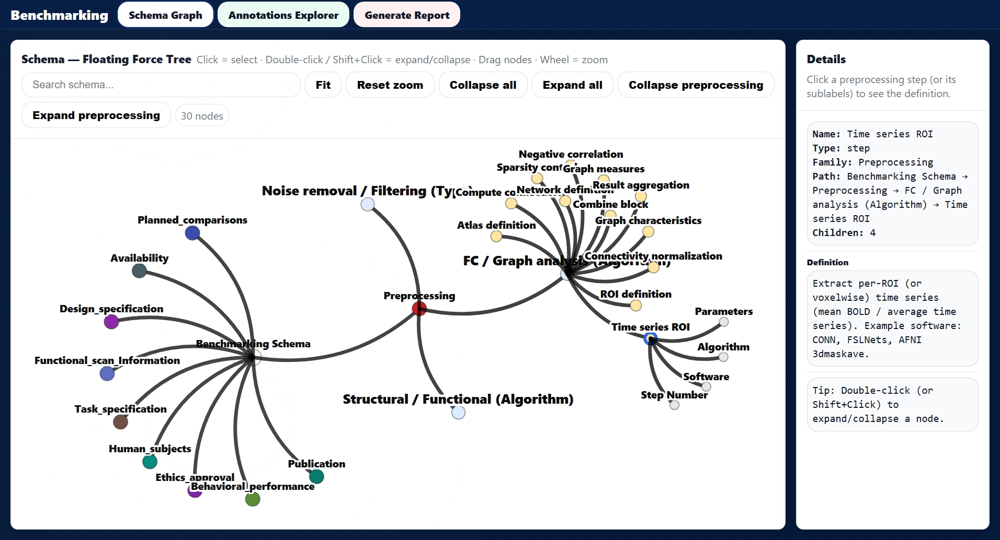
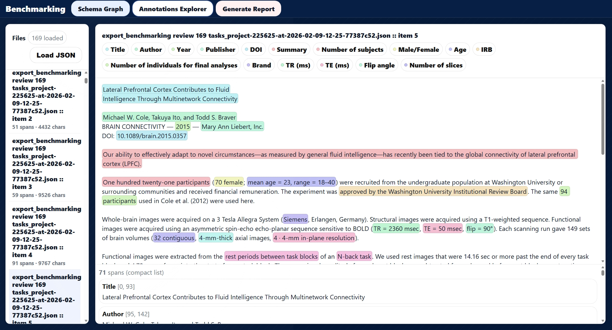
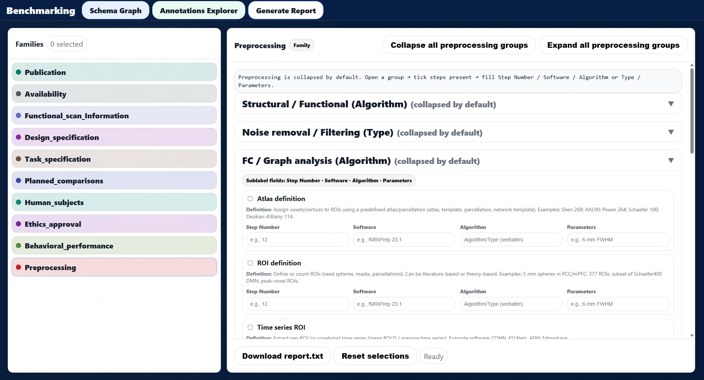
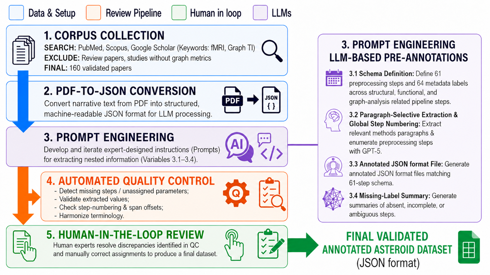

# ASTEROID: Validated Annotated Dataset of Graph Theory-Based fMRI Analytical Decisions

[](https://asteroid.shinyapps.io/asteroid/)

## Overview

**ASTEROID** is a structured, expert-reviewed annotation dataset describing analytical decisions reported in published graph theory-based human functional magnetic resonance imaging (fMRI) research. It supports the systematic examination of methodological choices in fMRI preprocessing, functional-connectivity analysis, and graph-theoretical network analysis.

The accompanying manuscript describes annotations from **156 studies** using a schema of **125 labels**: **61 methodological labels** and **64 labels** covering study characteristics and experimental design. The annotations were produced through an LLM-assisted workflow, followed by automated quality-control procedures and human expert review. The final annotations include methodological steps, software, algorithms/types, parameters, and links to supporting text spans where available.

## Contents

- Final human-reviewed annotations in Label Studio-compatible JSON format
- Source-study bibliography and schema-labeled supporting text spans in Excel format
- Intermediate JSON outputs from different prompting strategies
- Prompt specifications used for LLM-assisted pre-annotation
- Scripts supporting merging, mismatch assessment, summary generation, and review
- Interactive ASTEROID application for exploring the schema and annotations
- Supporting images and workflow visualizations

## Main dataset

**Path:** [`Annotated_Files/all_annotations.json`](Annotated_Files/all_annotations.json)

The consolidated JSON contains structured records representing the reviewed source studies. Its annotations cover:

1. **Study characteristics:** bibliographic and participant/study information.
2. **Experimental design:** functional-scan and experimental-design information.
3. **Analytical pipeline:** methodological decisions involving structural and functional preprocessing, noise removal/filtering, functional connectivity, and graph analysis.

Methodological annotations include standardized attributes such as step number, software, algorithm/type, and parameters. Source text spans are provided where available. Missing or ambiguous fields should be interpreted in the context of the original studies' reporting, not automatically as evidence that an analysis step was not performed.

**Data format:** JSON, structured for compatibility with Label Studio annotation import. The contents should be inspected using the included schema documentation and/or the ASTEROID viewer.

**Source studies and annotation spans:** [`Annotated_Files/source_studies_with_annotations.xlsx`](Annotated_Files/source_studies_with_annotations.xlsx)

The Excel workbook provides a searchable overview of the 156 source studies, including bibliographic metadata, DOI links, identified schema labels, and supporting annotated text spans. The **Source Studies** sheet summarizes labels and text evidence per study; **Annotation Text Spans** lists individual spans with their schema groups, labels, and start/end offsets; and **Schema Labels** summarizes label frequencies. Offsets are character positions in the text imported for annotation, **not** PDF page numbers or page coordinates. The validated JSON above remains the primary annotation dataset.

**Data dictionary/schema:** [`Schema_Viewer/Schema.html`](Schema_Viewer/Schema.html)

`Schema.html` contains the Label Studio annotation schema used for ASTEROID. It organizes labels for study characteristics, experimental design, fMRI preprocessing, functional connectivity, and graph analysis, and defines methodological sublabels such as step number, software, algorithm/type, and parameters. It can be used to interpret the labels in the JSON dataset and Excel workbook.


## Repository organization

The ASTEROID repository is organized into the following directories and files:
```text
ASTEROID-Validated-Annotated-Dataset/
├── README.md
├── Prompts/
│   ├── First Prompt.md
│   ├── GA Prompt.md
│   └── Final Prompt.md
├── JSON_Files/
│   ├── Firstprompt/
│   ├── GAprompt/
│   ├── Finalprompt/
│   └── Combined JSON/
├── Annotated_Files/
│   ├── all_annotations.json
│   └── source_studies_with_annotations.xlsx
├── Python_Scripts/
│   ├── combine_summary.py
│   ├── mismatch_checker.py
│   ├── merge_json_files.py
│   ├── requirements.txt
│   └── review_newversion.py
├── Schema_Viewer/
│   ├── ASTEROID.html
│   └── Schema.html
└── Images/
    ├── workflow.png
    ├── explorer1.jpeg
    ├── explorer2.jpeg
    └── explorer3.jpeg

    
```

### Intermediate JSON outputs

`JSON_Files/` contains LLM-generated pre-annotation outputs:

- `Firstprompt/`: outputs from the initial broad extraction prompt.
- `GAprompt/`: outputs from the graph-analysis-focused extraction prompt.
- `Finalprompt/`: outputs from the refined single-pass prompt.
- `Combined JSON/`: outputs combining first-prompt and graph-analysis annotations.


The manuscript describes a staged extraction process: initial and graph-analysis prompting with merged outputs for the first 80 studies, followed by a refined prompt for the remaining 76. These intermediate files should **not** be confused with the final human-reviewed dataset in `Annotated_Files/`.

### Prompt specifications

`Prompts/` contains the schema-guided prompts used for LLM-assisted pre-annotation of the source studies:

- **First Prompt:** Initial extraction of publication details, study characteristics, and methodological information.
- **GA Prompt:** Focused extraction of functional-connectivity and graph-analysis decisions to supplement the initial output.
- **Final Prompt:** Refined prompt combining the extraction requirements into a more consistent single-pass workflow.

These prompts document how the extraction strategy evolved. Their outputs were subsequently checked and reviewed; the final human-validated annotations are provided in [`Annotated_Files/all_annotations.json`](Annotated_Files/all_annotations.json). 

### Python scripts and reference data

`Python_Scripts/` contains supporting utilities used during dataset preparation and validation:

| Script | Purpose |
| --- | --- |
| `combine_summary.py` | Combines comparison reports and summarizes validation outcomes. |
| `mismatch_checker.py` | Checks discrepancies against the manually curated reference data. |
| `merge_json_files.py` | Combines initial and graph-analysis JSON outputs. |
| `review_newversion.py` | Generates comparison reports between extracted annotations and reference data. |

**Manual reference database:** [METEOR `Database.xlsx`](https://github.com/metascience-uol/METEOR/blob/main/Database.xlsx) (see worksheet `Seed2`). The comparison scripts are written to use the `Seed2` reference-table structure. This external database is distinct from ASTEROID's `source_studies_with_annotations.xlsx` bibliography and annotation-span workbook. Please consult the METEOR repository for the database's provenance, version, and reuse conditions.

The scripts use Python and the packages `pandas`, `numpy`, and `openpyxl` (see [`Python_Scripts/requirements.txt`](Python_Scripts/requirements.txt)). They are shared to document supporting processing and quality-control steps. Some operations depend on intermediate files, local directory arrangements, and manual expert review. The final human-reviewed annotations are available directly in [`Annotated_Files/all_annotations.json`](Annotated_Files/all_annotations.json).

## Interactive ASTEROID application

ASTEROID provides two ways to explore the annotation schema and dataset:

1. Standalone HTML viewer

A standalone HTML viewer is also included in the GitHub repository:

[`Schema_Viewer/ASTEROID.html`](Schema_Viewer/ASTEROID.html)

The file can be downloaded and opened locally in a compatible web browser.

2. 1. Online Shiny application

Access the interactive ASTEROID application directly through your browser:
https://asteroid.shinyapps.io/asteroid/

The interactive application supports three core activities:

1. **Schema Graph:** Explore the relationships among annotation families, groups, steps, and sublabels, including descriptions and hierarchy.
2. **Annotations Explorer:** Load compatible annotation JSON and inspect the supporting text and label assignments.
3. **Generate Report:** Select reported analysis steps and provide corresponding step numbers, software, algorithms/types, and parameters to create a structured summary.

**Using the viewer:**

1. Open the application URL in a modern browser.
2. Select the relevant tab.
3. To examine final annotations, download [`Annotated_Files/all_annotations.json`](Annotated_Files/all_annotations.json) and upload it through the viewer's file selector, if prompted.
4. Use the Schema Graph and reporting interface to explore the annotation framework.

The app is a visualization and inspection tool; the downloadable, archived JSON dataset remains the authoritative data record. 

### Application screenshots

#### Tab 1 — Schema Graph

Explore the hierarchical annotation schema and inspect
relationships between label groups, steps, and sublabels.



#### Tab 2 — Annotations Explorer

Load compatible JSON annotation files and examine
highlighted text spans and assigned labels.



#### Tab 3 — Generate Report

Create structured summaries of preprocessing and
graph-analysis decisions.




## Dataset creation and validation

### ASTEROID Dataset Construction Workflow

The following diagram illustrates the ASTEROID dataset
construction process, including literature collection,
PDF-to-JSON conversion, LLM-assisted pre-annotation,
automated quality control, and expert human review.



The manuscript describes the following workflow:

1. Compile a corpus of published graph theory-based human fMRI studies.
2. Convert source PDFs to structured text/JSON.
3. Produce initial schema-guided annotations using LLM prompts.
4. Run automated checks for missing/duplicated decisions, parameter formatting, step numbering, and span offsets.
5. Compare annotation outputs with a previously compiled manual extraction resource.
6. Review flagged and ambiguous records using human expertise, and export the validated annotation dataset.

The PDF-to-JSON conversion tool is documented separately in [Annotation-buddy](https://github.com/sanahassanimam/Annotation-buddy).

The manual comparison is an evaluation resource, not absolute ground truth. The manuscript reports targeted expert review and discussion to resolve uncertain cases; it does **not** report an independent parallel annotation study or inter-annotator agreement statistic. Consult the accompanying manuscript for the precise validation methodology and limitations.

## Reuse and limitations

ASTEROID is intended for examining reported methodological decisions in graph theory-based human fMRI studies, supporting comparisons across studies, identifying plausible choices for multiverse analyses, and evaluating automated scientific information-extraction workflows.

The dataset records information **as reported** in source publications. An unreported annotation does not necessarily mean the corresponding method was not used. Ordering information and source-text support should be interpreted according to the annotation definitions and documented workflow. Use caution in applying the schema outside its source domain without additional validation.

## Data availability and versioning

- **GitHub project:** https://github.com/sanahassanimam/ASTEROID-Validated-Annotated-Dataset
- **Archived dataset:** Zenodo record in preparation; a permanent DOI will be added upon publication.
- **Version-specific DOI:** Zenodo record in preparation; a permanent DOI will be added upon publication.
- **Dataset version/release:** Zenodo record in preparation; a permanent DOI will be added upon publication.
- **Online viewer:** https://asteroid.shinyapps.io/asteroid/

For scholarly citation, use the exact archived dataset version and its DOI once registered. The GitHub repository may evolve independently of the archived version used in the manuscript.

## Licence and third-party source material

The ASTEROID repository uses separate licences for research data and software:

- **Dataset and documentation:** Original ASTEROID annotations, structured dataset metadata, schema documentation, and other original non-code materials are licensed under the [Creative Commons Attribution 4.0 International License (CC BY 4.0)](https://creativecommons.org/licenses/by/4.0/).
- **Software:** Original Python scripts in the `python_scripts/` directory are licensed under the [MIT License](https://opensource.org/license/mit). See [`python_scripts/LICENSE`](python_scripts/LICENSE).

**Third-party source material:** The dataset includes supporting text spans extracted from published scientific articles. These excerpts remain attributed to their original publications, identifiable through the accompanying bibliographic information and DOI references. Copyright in third-party material remains with the respective rights holders; the ASTEROID licences apply only to material that the contributors are entitled to license.

Users should consult the original publications and their applicable reuse conditions when reusing third-party text.

## Citation

**Dataset:** ASTEROID — Validated Annotated Dataset of Graph Theory-Based fMRI Analytical Decisions. Zenodo dataset archive (DOI to be added upon publication of the record).

**Related Data Descriptor:** Imam et al., "ASTEROID: A Validated Annotated Dataset of Graph Theory–Based fMRI Analytical Decisions Derived by LLM-Assisted Literature Mining." Manuscript under review.


## Contact

**Sana Hassan Imam**  
Carl von Ossietzky Universität Oldenburg  
GitHub: [sanahassanimam](https://github.com/sanahassanimam)  
Email: sana.hassan.imam@uni-oldenburg.de
